# Crypto logos: SVG coin icons by symbol, light and dark

Free crypto coin logos as SVG, by ticker symbol. Every coin has a light and a dark version. No API key, no signup, no attribution.

```html


```

- **URL pattern:** `https://logoapi.sh/crypto/{SYMBOL}.svg`, dark mode: `https://logoapi.sh/dark/crypto/{SYMBOL}.svg`
- **Unknown symbol:** add `?fallback=404` to get a clean 404 instead of a letter tile.
- **Hot-link the logoapi.sh URLs, not raw GitHub links.** They come from a CDN and pick up new coins and fixes. Raw GitHub links are not meant for serving images in an app.
- **Offline:** every file is in this repo, in `svg/light/` and `svg/dark/`. `index.json` maps symbol, name and paths.
- **Files:** 37 coins, all vector SVG, no embedded raster images. Logos come from each project's official brand files.
- **Limits:** the hosted URLs are free up to 2M requests a month per site, served from a CDN with `Access-Control-Allow-Origin: *`.

## Coins

| Light | Dark | Symbol | Name | URL |
|---|---|---|---|---|
|  |  | `BTC` | Bitcoin | `logoapi.sh/crypto/BTC.svg` |
| 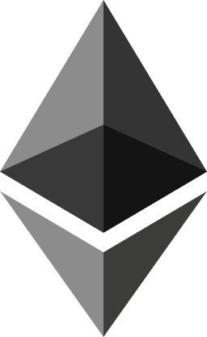 | 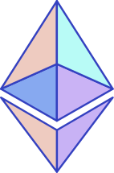 | `ETH` | Ethereum | `logoapi.sh/crypto/ETH.svg` |
|  |  | `USDT` | Tether | `logoapi.sh/crypto/USDT.svg` |
|  | 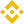 | `BNB` | BNB | `logoapi.sh/crypto/BNB.svg` |
|  | 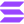 | `SOL` | Solana | `logoapi.sh/crypto/SOL.svg` |
|  |  | `XRP` | XRP | `logoapi.sh/crypto/XRP.svg` |
|  |  | `USDC` | USD Coin | `logoapi.sh/crypto/USDC.svg` |
| 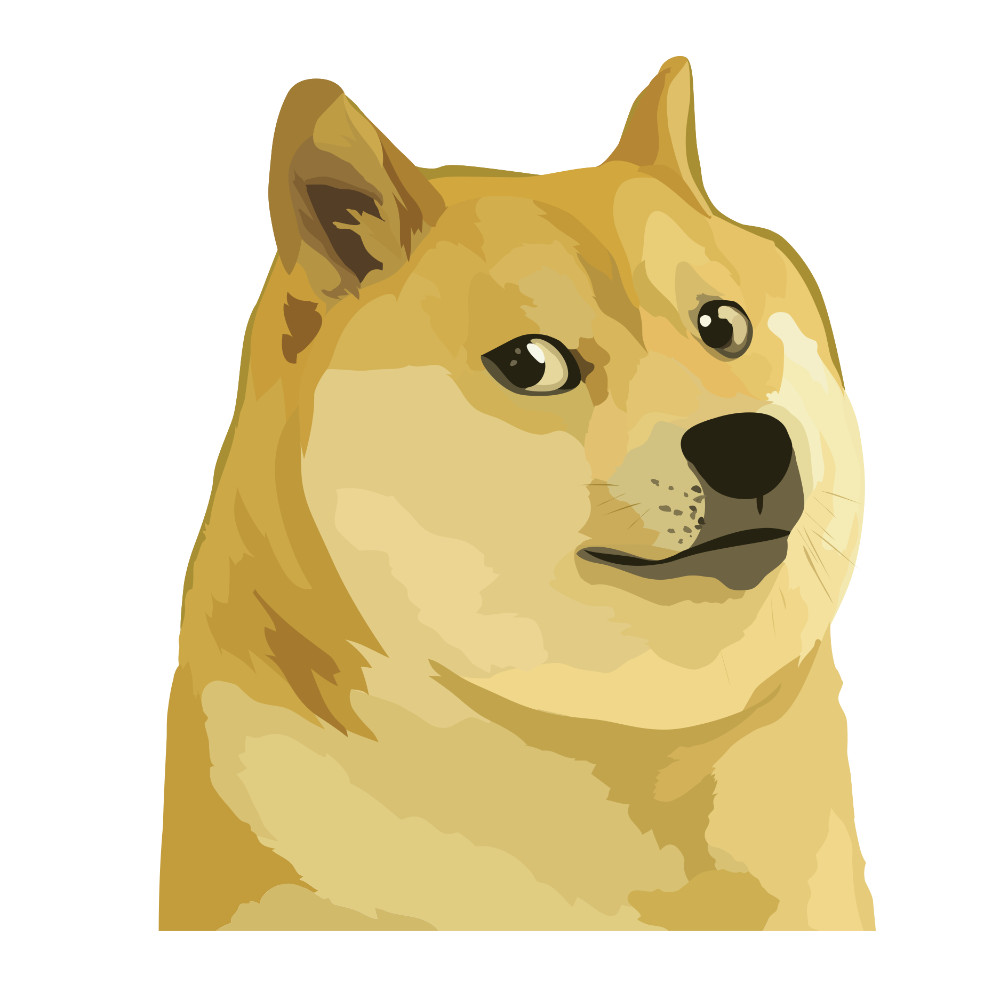 |  | `DOGE` | Dogecoin | `logoapi.sh/crypto/DOGE.svg` |
| 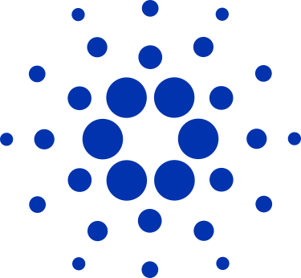 |  | `ADA` | Cardano | `logoapi.sh/crypto/ADA.svg` |
| 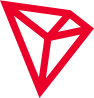 |  | `TRX` | TRON | `logoapi.sh/crypto/TRX.svg` |
|  |  | `AVAX` | Avalanche | `logoapi.sh/crypto/AVAX.svg` |
|  |  | `TON` | Toncoin | `logoapi.sh/crypto/TON.svg` |
|  |  | `DOT` | Polkadot | `logoapi.sh/crypto/DOT.svg` |
| 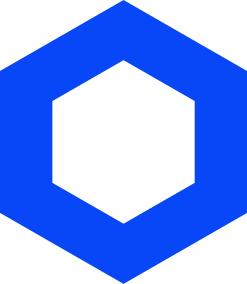 |  | `LINK` | Chainlink | `logoapi.sh/crypto/LINK.svg` |
|  |  | `SHIB` | Shiba Inu | `logoapi.sh/crypto/SHIB.svg` |
|  |  | `SUI` | Sui | `logoapi.sh/crypto/SUI.svg` |
|  |  | `ARB` | Arbitrum | `logoapi.sh/crypto/ARB.svg` |
| 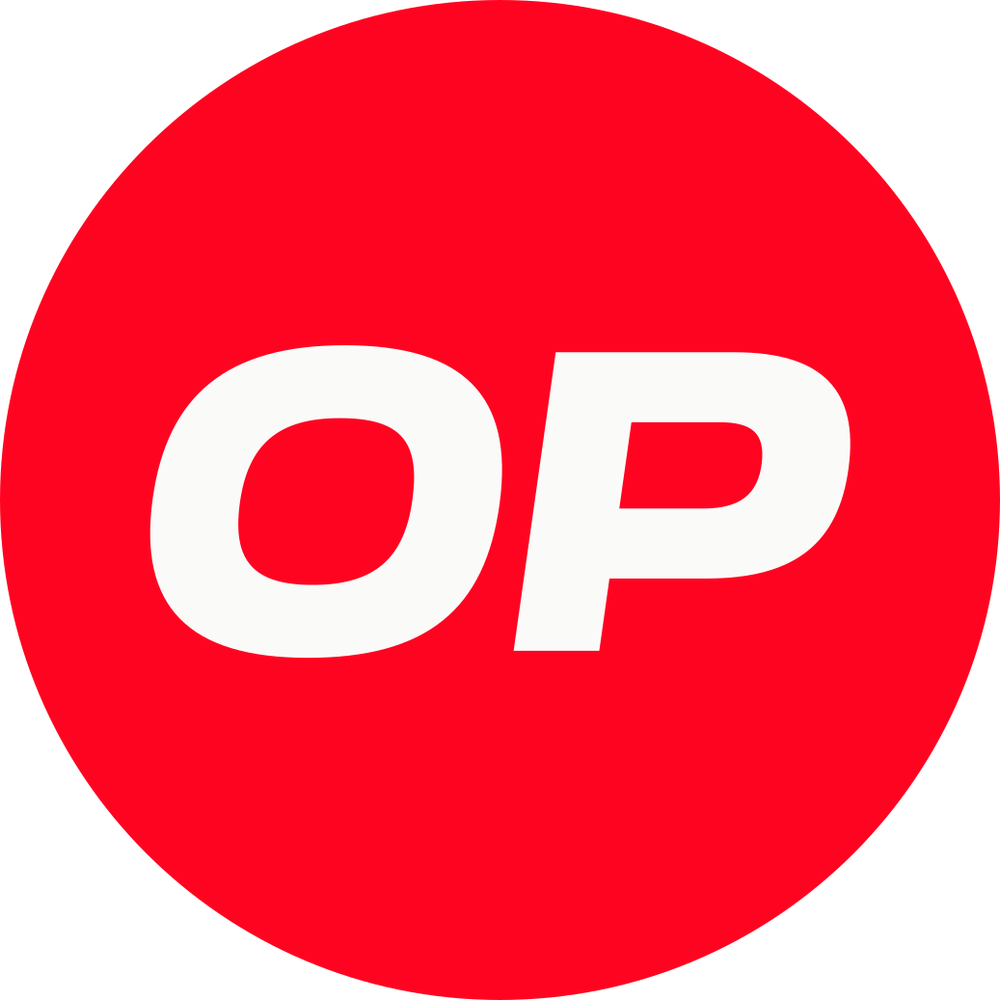 |  | `OP` | Optimism | `logoapi.sh/crypto/OP.svg` |
|  |  | `NEAR` | NEAR Protocol | `logoapi.sh/crypto/NEAR.svg` |
|  |  | `XLM` | Stellar | `logoapi.sh/crypto/XLM.svg` |
| 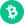 |  | `BCH` | Bitcoin Cash | `logoapi.sh/crypto/BCH.svg` |
| 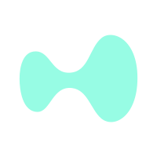 |  | `HYPE` | Hyperliquid | `logoapi.sh/crypto/HYPE.svg` |
|  | 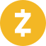 | `ZEC` | Zcash | `logoapi.sh/crypto/ZEC.svg` |
|  |  | `INJ` | Injective | `logoapi.sh/crypto/INJ.svg` |
|  |  | `TIA` | Celestia | `logoapi.sh/crypto/TIA.svg` |
|  |  | `SEI` | Sei | `logoapi.sh/crypto/SEI.svg` |
|  |  | `JUP` | Jupiter | `logoapi.sh/crypto/JUP.svg` |
|  |  | `ONDO` | Ondo | `logoapi.sh/crypto/ONDO.svg` |
| 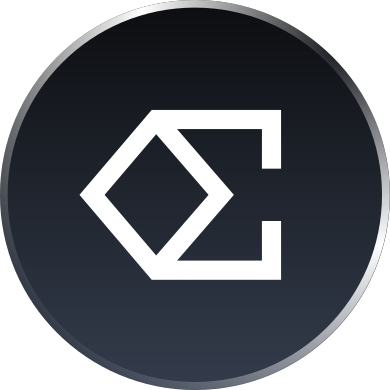 |  | `ENA` | Ethena | `logoapi.sh/crypto/ENA.svg` |
|  |  | `PENDLE` | Pendle | `logoapi.sh/crypto/PENDLE.svg` |
|  |  | `KAS` | Kaspa | `logoapi.sh/crypto/KAS.svg` |
|  |  | `HBAR` | Hedera | `logoapi.sh/crypto/HBAR.svg` |
| 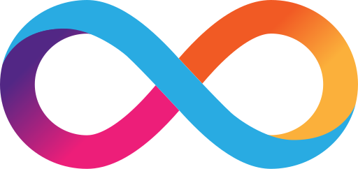 | 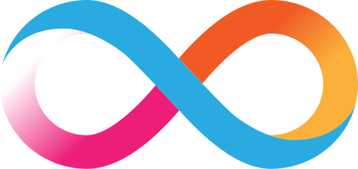 | `ICP` | Internet Computer | `logoapi.sh/crypto/ICP.svg` |
|  |  | `FIL` | Filecoin | `logoapi.sh/crypto/FIL.svg` |
|  |  | `AAVE` | Aave | `logoapi.sh/crypto/AAVE.svg` |
| 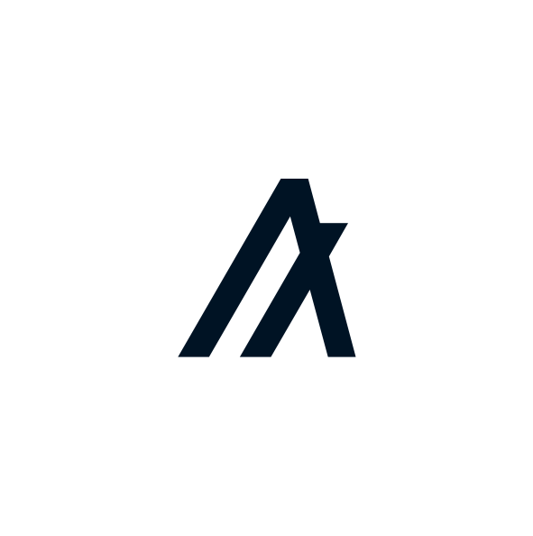 |  | `ALGO` | Algorand | `logoapi.sh/crypto/ALGO.svg` |
|  |  | `SKY` | Sky | `logoapi.sh/crypto/SKY.svg` |

Missing a coin? Open an issue with the symbol. We only add official brand files, never redrawn ones.

## React

```jsx
const CoinLogo = ({ symbol, dark }) => (
   (e.currentTarget.style.visibility = "hidden")}
  />
);
```

npm: [`crypto-logos`](https://www.npmjs.com/package/crypto-logos) returns these URLs. Stocks, ETFs and company domains: [logoapi/logo-api](https://github.com/logoapi/logo-api). Docs: [logoapi.sh/docs/crypto](https://logoapi.sh/docs/crypto).

## Licence

Code, `index.json` and this README: MIT, see LICENSE. Each logo is a trademark of its owner. The files are here so software can show which coin a price or balance belongs to. Using them does not imply endorsement or affiliation. Owners can ask for a change or removal at https://logoapi.sh/claim.
